# AVA Paradroid

[](https://github.com/Harlock123/AVAParadroid/actions/workflows/build.yml)

A top-down shooter and strategy game in the style of Graftgold's 1985 Commodore 64 game **Paradroid**, built
with .NET 10 and Avalonia UI. The crew of the freighter *Meridian* are gone, and its droids have turned. You are
**001**, a link unit: weak on your own and unarmed, but able to take over any droid that loses a transfer duel
to you. Clear all six decks.

## Features

- **Droids by number.** Every droid carries its number, and the hundreds are its class: cleaners (1xx) and
  couriers, through servicers, engineers, stewards, sentries and guards, to the wardens (8xx) and the
  commander, **920**. Higher classes are tougher, faster and better armed, and the sentries and above hunt you
  on sight. Lower ones go about their business until they're shot at.
- **The transfer duel.** Turn on the transfer charge and ram a droid. Twelve rows of wiring run each side of a
  column of cells: straight wires, burnt-out ones, and forks that reach two cells. You and the droid each have
  a few pulses; a pulse sent down a wire takes its cell (or two). When time runs out, whoever holds more cells
  wins. Win, and you take the droid over, with its body, its gun and its energy. Lose in a host, and the host
  burns out, leaving you as the bare link unit; lose as the link unit, and that's a life. The class you're in
  brings more pulses.
- **Hosts burn out.** A droid under your control slowly loses energy, the higher the class the faster, so
  keep moving up. Recharging pads on every deck top you up.
- **Six decks:** Bridge, Quarters, Stores, Laboratory, Machinery and the Reactor, each a maze of rooms and
  corridors. Doors slide open for anything that comes near and stop shots when shut. Each deck is more
  crowded and more dangerous than the last. Clear a deck and its lights go down.
- **The lifts.** Three shafts run between overlapping decks; on a lift pad, the button shows the ship in
  section, and you choose a deck to go to.
- **After the Meridian,** another ship, with more droids, of higher classes.
- **The ship's computer speaks:** "Transfer", "Deck cleared", "Vessel clear". The voice comes from a small
  formant synthesiser in the build tools.
- **Original music:** a slow, watchful hum in A minor for the decks, a title theme and jingles.
- **The attract mode** shows the computer player at work. It picks its droids: a class or two above what it's
  in, to take over; anything it can outgun, to shoot. It finds its way by the deck's map, lines up along the
  eight directions to shoot, saves its pulses for the end of a duel, recharges when it must, and takes the lift
  to the decks still to clear.

## Screenshots

| The title | The bridge | A transfer duel |
|:---------:|:----------:|:---------------:|
| 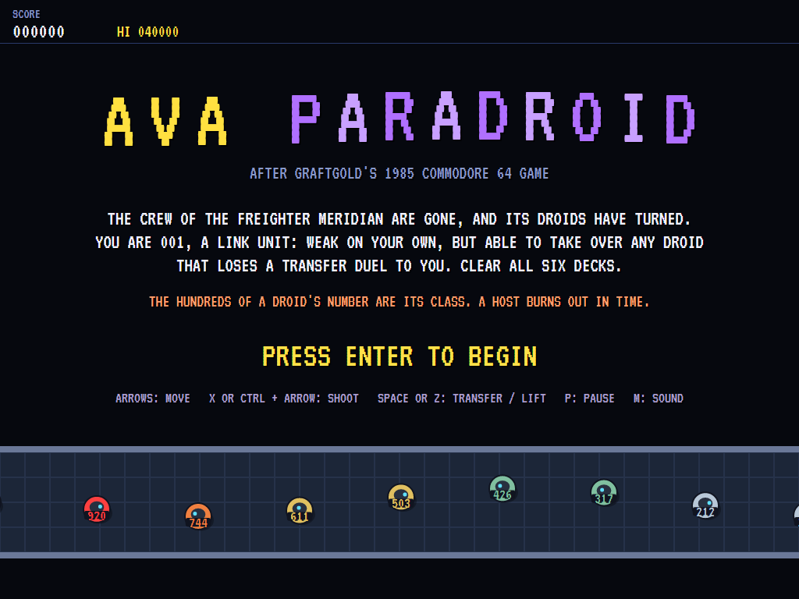 | 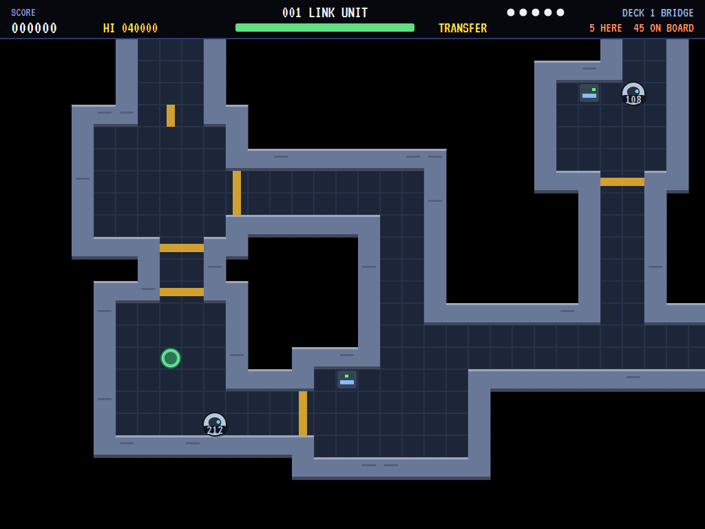 | 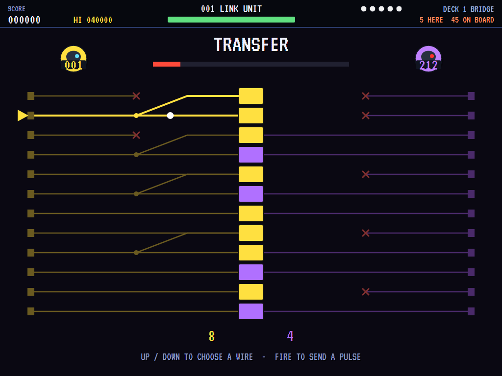 |
| The droids go by. | 001, transfer charge on. | Yellow against violet. |

| Transfer complete | A gunfight | The lift |
|:-----------------:|:----------:|:--------:|
| 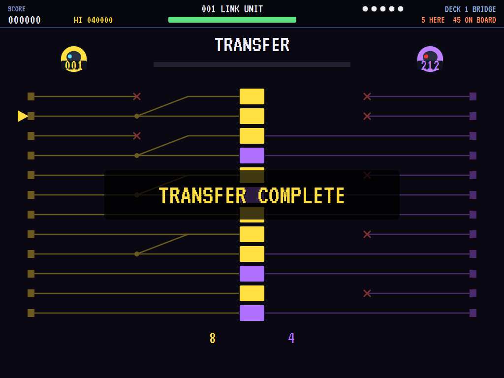 | 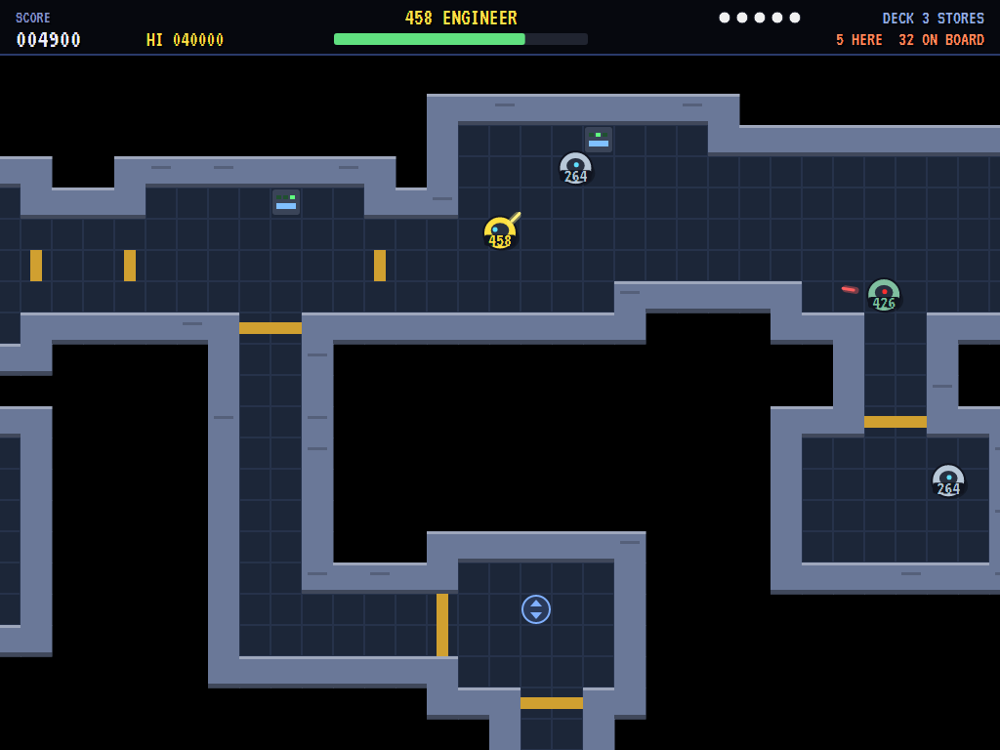 | 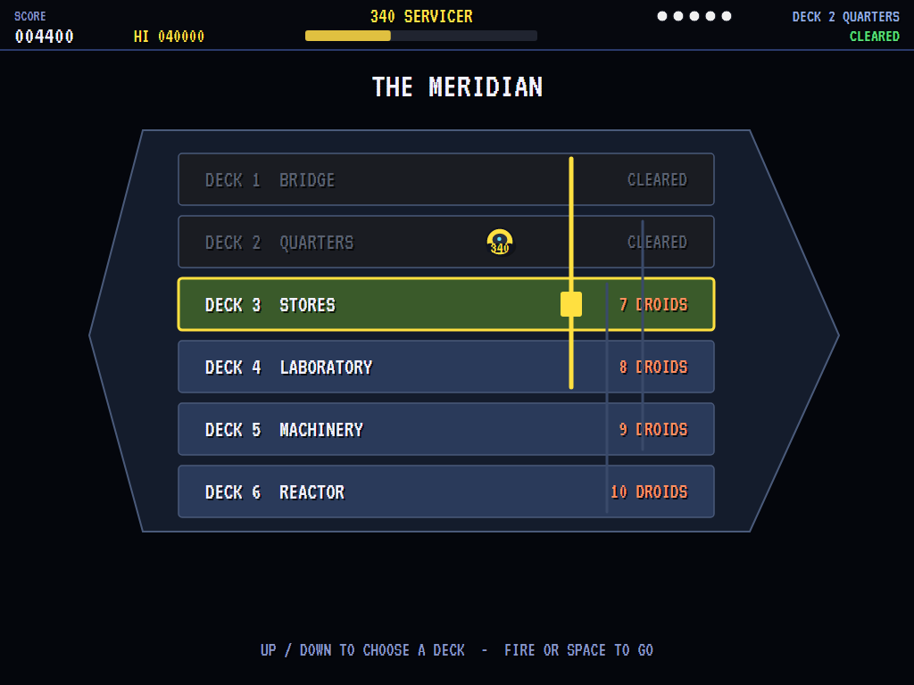 |
| The droid is yours. | In a host, shooting it out. | The ship in section. |

| Recharging | A cleared deck | Machinery |
|:----------:|:--------------:|:---------:|
| 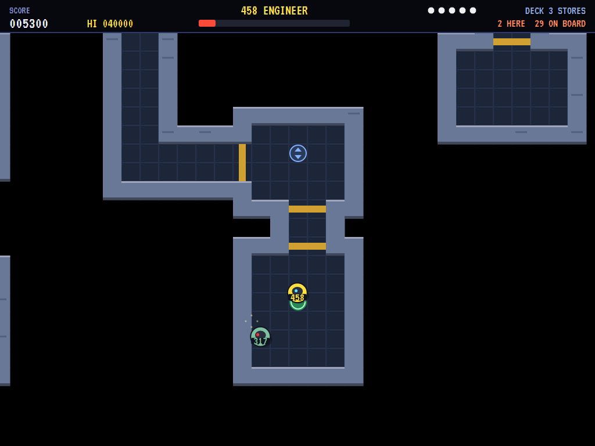 | 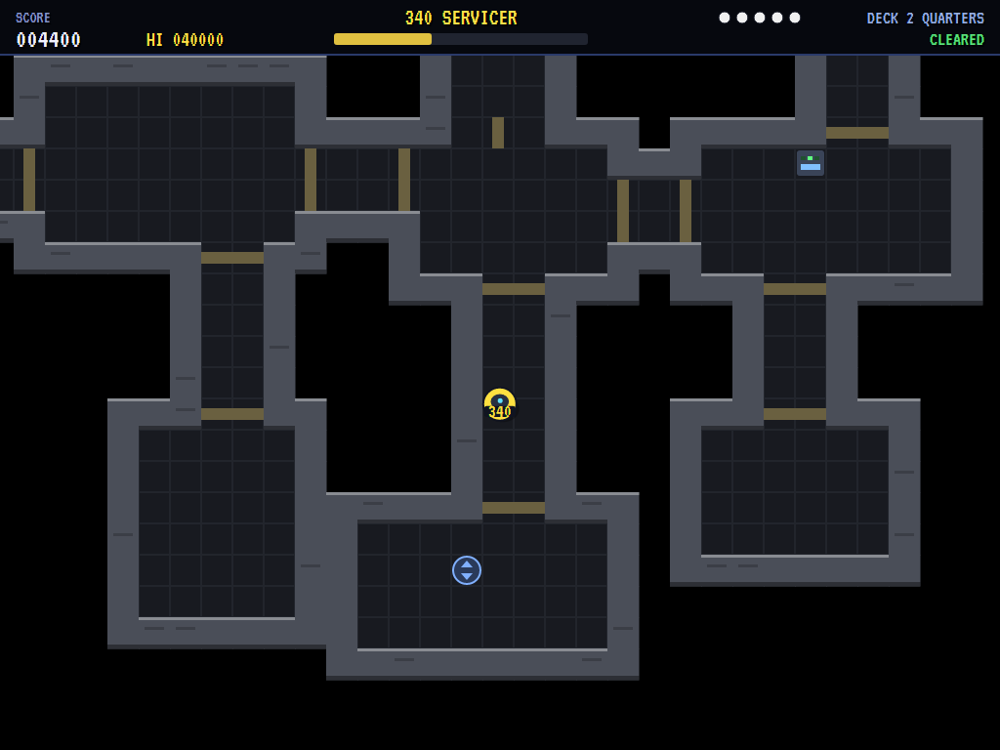 | 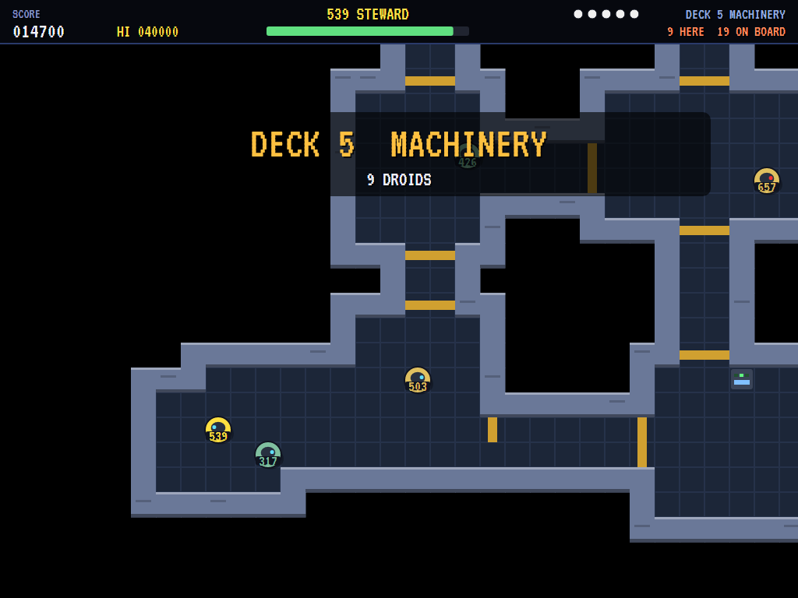 |
| On the pad. | Its lights down. | Deep in the ship. |

| The commander | Host lost | The best link units |
|:-------------:|:---------:|:-------------------:|
| 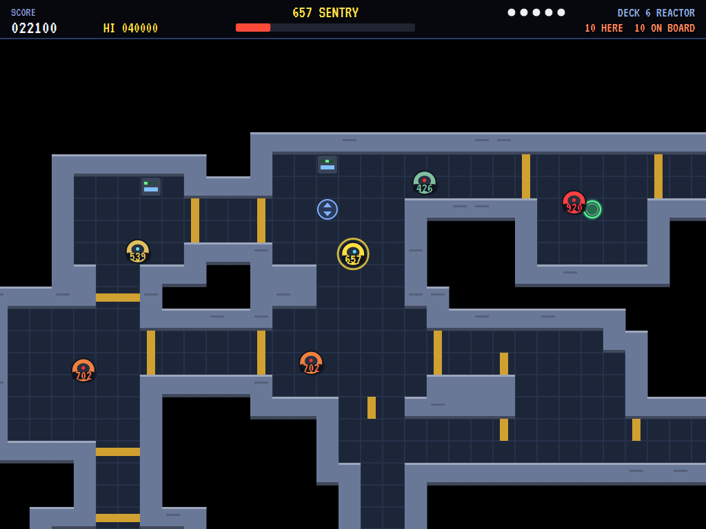 | 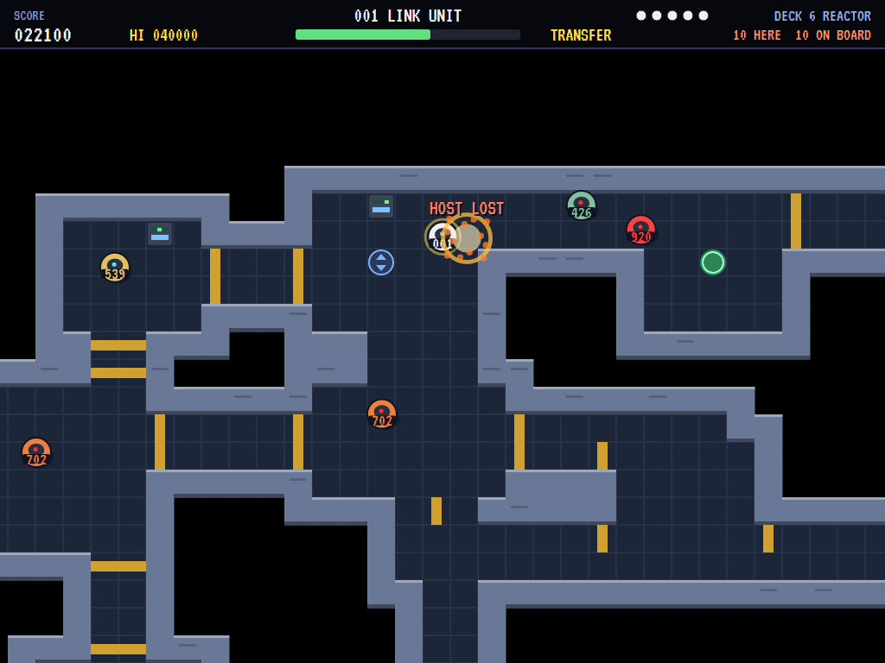 | 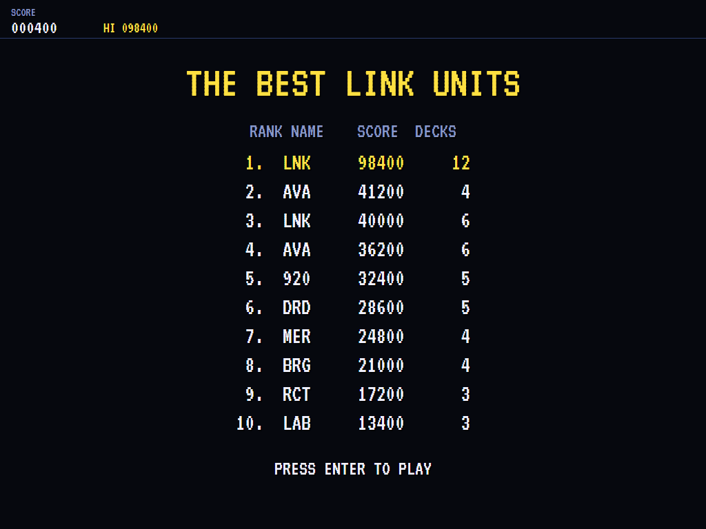 |
| 920, in the reactor. | Burnt out: back to 001. | The high-score table. |

The screenshots are made by the tests, which play the game in a real (headless) window; see
[Tests](#tests).

## Download and run

Ready-to-run builds for Windows, macOS and Linux, on both Intel/AMD and ARM, are on the
[Releases page](https://github.com/Harlock123/AVAParadroid/releases/tag/latest). **Latest build** is
rebuilt on every push to `main`. Each download is one self-contained executable: no .NET install is
needed.

| Platform | Archive |
|---|---|
| Windows | `AVAParadroid-win-x64.zip`, `AVAParadroid-win-x86.zip`, `AVAParadroid-win-arm64.zip` |
| macOS | `AVAParadroid-osx-arm64.tar.gz` (Apple silicon), `AVAParadroid-osx-x64.tar.gz` (Intel) |
| Linux | `AVAParadroid-linux-x64.tar.gz`, `AVAParadroid-linux-arm64.tar.gz`, `AVAParadroid-linux-arm.tar.gz` |

```bash
tar -xzf AVAParadroid-linux-x64.tar.gz     # or linux-arm64, linux-arm, osx-arm64, osx-x64
./AVAParadroid
```

On Windows, unzip and run `AVAParadroid.exe`. On macOS, if Gatekeeper refuses to open it, run
`xattr -d com.apple.quarantine AVAParadroid` once. Run with `--no-audio` for silence.

**Sound** comes through OpenAL Soft, built in for every platform. In a virtual machine the game
detects it and uses a larger audio buffer, so the sound doesn't break up.

**Gamepads** use SDL2, which is bundled for Windows, macOS and Intel/AMD Linux. ARM Linux builds need it
installed; without it the keyboard still works:

```bash
sudo apt install libsdl2-dev            # Debian / Ubuntu / Raspberry Pi OS
sudo pacman -S --needed sdl2-compat     # Arch / Omarchy
```

## Controls

| Action | Keyboard | Gamepad |
|---|---|---|
| Start | Enter or 1 | Start |
| Move | Arrows or W/A/S/D | Left stick / D-pad |
| Shoot (in a host with a gun) | Hold X, Ctrl or Shift and push a direction | Hold B, X or right trigger and push a direction |
| Transfer charge on/off, or the lift (on a pad) | Space or Z | A |
| In the duel | Up/down to choose a wire, fire or Space to send a pulse | |
| In the lift | Up/down to choose a deck, fire or Space to go | |
| Pause | P or Esc | Start or Back |
| Sound on/off | M | |
| Screenshot | Ctrl+S (to your Pictures folder) | |

On the high-score table, type your initials, or use up/down and Space, then Enter.

## Tests

```bash
dotnet test AVAParadroid.slnx
```

The game runs in fixed 60 Hz steps, so it plays the same at any frame rate. The tests check:

- **The ship:** every square of every deck can be reached; every deck has a recharger and a lift on each
  shaft that stops there, and the shafts join every deck; each deck has its droids, of the classes that
  belong that deep, and the commander waits in the reactor. The computer player clears the ship.
- **Moving and shooting:** walls stop you; the bare link unit has no gun, but a host shoots the way it's
  pushed; shots bring droids down for points; a droid shot at turns on you and shoots back; a host burns
  out and leaves the link unit; shot down bare is the end; the recharger fills you up; doors open for what
  comes near.
- **Transfer:** the charge and a touch start the duel; a pulse takes its cell, a fork two and a dead wire none;
  higher classes bring more pulses; winning takes the droid over, and losing in a host loses the host.
- **The lift and the decks:** the lift takes you to another deck on its shaft; a cleared deck is a bonus and
  every droid gone clears the ship, and the next one comes; a life lost starts again as 001 by the
  recharger; the last life and the high-score table; the demonstration and the high scores; the keys.

`tests/AVAParadroid.Tests/PilotProbe.cs` reports how the computer player gets on clearing the ship, for tuning
(`PARADROID_PROBE=1`; `PARADROID_PROBE=lazy` for a player who only wanders and fires).

The screenshot tests draw the real screen in a headless window. To refresh the README's pictures:

```bash
PARADROID_SHOTS=$PWD/Images dotnet test tests/AVAParadroid.Tests --filter ScreenshotTests
```

## Building

```bash
dotnet build AVAParadroid.slnx
dotnet run --project src/AVAParadroid
```

Needs the .NET 10 SDK. The sounds, the voice and the tunes are made by `tools/make_sounds.py`
(standard-library Python, with `tools/speech.py` for the voice): `python3 tools/make_sounds.py` rewrites
`src/AVAParadroid/Sounds`.

## Project structure

```
AVAParadroid/
├── AVAParadroid.slnx
├── src/AVAParadroid/
│   ├── Engine/
│   │   ├── GameEngine.cs        # States, lives, the duel, the lift, decks and ships in turn, the title and demonstration
│   │   ├── Sim.cs               # A deck step by step: moving, shooting, the droids, doors, recharging, burning out
│   │   ├── Transfer.cs          # The transfer duel
│   │   ├── World.cs             # The droids of every deck, the player, shots
│   │   ├── Ship.cs              # Squares, droid classes, and how a ship's decks are built
│   │   ├── Pilot.cs             # The computer player (the demonstration, and the tests)
│   │   ├── HighScoreTable.cs, InitialsEntry.cs
│   │   ├── InputHandler.cs, ControllerManager.cs  # Keys and an SDL2 gamepad
│   │   └── SoundManager.cs      # Effects, the voice and the music through OpenAL
│   ├── Audio/                   # The OpenAL engine (from the author's AVABand)
│   ├── Views/                   # The drawing: decks, droids, the duel, the lift
│   └── Sounds/                  # The synthesised effects, voice and tunes
├── tests/AVAParadroid.Tests/    # Ship, gameplay and screenshot tests
├── tools/make_sounds.py, tools/speech.py
└── Images/                      # Screenshots
```

## About and licence

AVA Paradroid © 2026 Lonnie Watson, under the [MIT License](LICENSE).

*Paradroid* © 1985 Hewson Consultants, written by Andrew Braybrook of Graftgold; the name belongs to its
current owner. AVA Paradroid is an independent, unofficial game in its style. Its ship, droids and their
numbers, its decks, graphics, sounds, voice, tunes and code are its own; nothing is taken from the original
game's program, graphics or sound. It is not affiliated with or endorsed by any rights holder.
